# ha-homelab-panel

[](https://www.home-assistant.io/integrations/marketplace/)
[](https://github.com/juju35/ha-homelab-panel/actions/workflows/hacs.yml)
[](https://github.com/juju35/ha-homelab-panel/actions/workflows/validate.yml)
[](https://github.com/juju35/ha-homelab-panel/actions/workflows/lint.yml)
[](https://github.com/juju35/ha-homelab-panel/releases/latest)
[](https://github.com/juju35/ha-homelab-panel/blob/main/LICENSE)
[](https://buymeacoffee.com/julienstep9)

<p align="center"></p>

<p align="center">
  <a href="https://www.proxmox.com"></a>&nbsp;&nbsp;
  <a href="https://www.docker.com"></a>&nbsp;&nbsp;
  <a href="https://www.portainer.io"></a>&nbsp;&nbsp;
  <a href="https://nas.ugreen.com"></a>&nbsp;&nbsp;
  <a href="https://www.synology.com"></a>&nbsp;&nbsp;
  <a href="https://www.qnap.com"></a>&nbsp;&nbsp;
  <a href="https://networkupstools.org">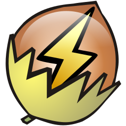</a>&nbsp;&nbsp;
  <a href="http://www.apcupsd.org"></a>&nbsp;&nbsp;
  <a href="https://uptime.kuma.pet"></a>
</p>

Home Assistant integration that adds a **Homelab** panel to the sidebar: your Proxmox VE hosts and machines, Docker containers, NAS (several side by side), UPS, monitored services, reverse proxy, backups and certificates on one page, read from the integrations you already have — and the restart, start and stop of a machine or a container one click away.

<p align="center">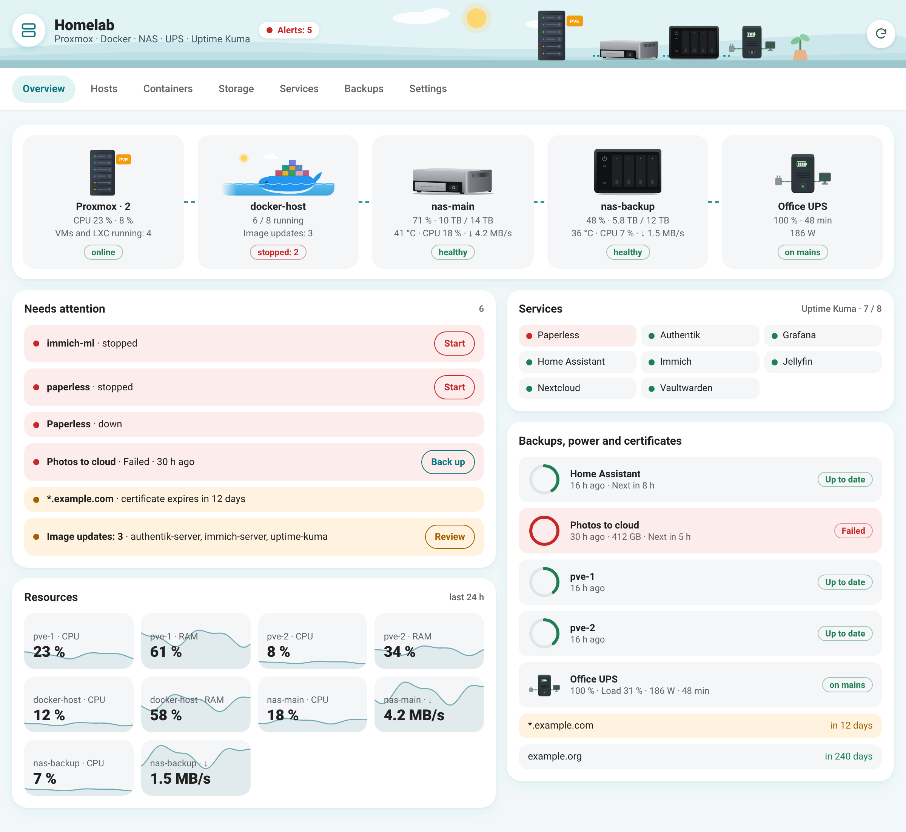</p>

[](https://my.home-assistant.io/redirect/marketplace_repository/?owner=juju35&repository=ha-homelab-panel&category=integration)

## Features

- **Illustrated top bar**: a 90 px picture of your homelab — the Proxmox rack, one drawing per NAS (the UGREEN, Synology and QNAP models of the NAS card), the UPS, cables — by day with a light theme, by night with a dark one; the title with a status pill (All good, or how many alerts), the sources found, and a round **Refresh** button; pill tabs under it
- **Overview**: one tile per source (Proxmox hosts, containers, NAS, UPS, services, certificates) with its count and state, then the hosts and their running machines, the containers to watch (stopped or with an image update), the NAS, the UPS, the services, the certificates and the backups at a glance
- **Hosts**: each Proxmox VE host with its gauges and uptime, then every virtual machine and LXC container with its status, host, CPU and RAM, and its start, restart or stop button
- **Containers**: as in ha-docker-card, per Dockhand environment or Portainer endpoint its CPU and memory with their last 24 hours, containers running, Docker version and platform, the stacks, images, volumes, networks and pending updates counters, the stacks (state, Git, sync error, update, start / stop) and the containers (state, health, status, image, CPU, memory, a search field, a sort by name, CPU or memory, a « needing attention » filter, and their image update, restart and start / stop buttons, confirmed first); Monitor Docker's containers keep their table with filters for all, stopped and updates
- **Storage**: as in ha-nas-card, one card per NAS with its drawing, status, OS version and update, uptime and CPU model, its restart and shutdown buttons (confirmed first), CPU, memory, temperatures and network rates with their last 24 hours, the volumes (RAID level, file system, state, used space), the disks (model, temperature, state, size, power-on hours, hot drives flagged) and the fans — UGREEN, Synology DSM and QNAP
- **Services**: the Uptime Kuma monitors (up first collapsed, down and pending listed), the reverse proxy and its hosts, and the certificates with their days left
- **Backups**: Home Assistant's last and next backup, late or failed flagged, and the last backup of each Proxmox host
- **Confirmation** before a restart or a stop, in a dialog
- **Settings**: the sources shown (with their state: connected, not loaded, not set up, entities found), the confirmation, stopped machines shown or not, and the warning thresholds of certificates (days) and drives (°C)
- **Administrators only**: the panel and its commands are kept for administrators
- Light and dark themes, phones and desktops, 22 languages
- No connection of its own: the panel reads the entities of the integrations below and presses their buttons

## Supported integrations

| | Integration | What it is used for |
|---|---|---|
|  | [Proxmox VE](https://www.home-assistant.io/integrations/proxmoxve/) (built in), or [Proxmox VE Custom](https://github.com/dougiteixeira/proxmoxve) | Hosts, virtual machines, LXC containers: status, CPU, RAM, disk, uptime, last backup, and their start / restart / stop buttons |
|  | [Proxmox Extended Sensors](https://github.com/Javisen/proxmox_sensors) | The hosts' temperature, joined to the Proxmox VE host of the same name |
|  | [Dockhand](https://github.com/raetha/ha-dockhand) | Docker environments and containers: status, image, CPU, RAM, updates, start / stop and restart |
|  | [Monitor Docker](https://github.com/ualex73/monitor_docker) | Docker hosts and containers (entities without devices, grouped by container) |
|  | [Portainer](https://www.home-assistant.io/integrations/portainer/) (built in) | Portainer endpoints and their containers |
|  | [UGREEN NAS](https://github.com/Tom-Bom-badil/home-assistant_ugreen-nas) | The NAS, its volumes and drives |
|  | [Synology DSM](https://www.home-assistant.io/integrations/synology_dsm/) (built in) | The NAS, its volumes and drives (SMART state, temperature) |
|  | [QNAP](https://www.home-assistant.io/integrations/qnap/) (built in) | The NAS, its volumes and drives |
|  | [Network UPS Tools](https://www.home-assistant.io/integrations/nut/) (built in) | The UPS: status, battery, runtime, load, power |
|  | [APC UPS Daemon](https://www.home-assistant.io/integrations/apcupsd/) (built in) | The same, for APC UPS |
|  | [Uptime Kuma](https://www.home-assistant.io/integrations/uptime_kuma/) (built in) | The monitored services: status, response time, certificate days |
|  | [Reverse Proxy](https://github.com/juju35/ha-reverse-proxy) | The reverse proxy (Zoraxy, Traefik, Nginx Proxy Manager): state and hosts |
|  | [Backup](https://www.home-assistant.io/integrations/backup/) (built in) | Home Assistant's last and next automatic backup |
|  | [Certificate Expiry](https://www.home-assistant.io/integrations/cert_expiry/) (built in) | The certificates and their expiry |

None is required: the panel shows the sources it finds, and says what to add when it finds none.

## Prerequisites

Home Assistant 2026.11 or later, and at least one of the integrations above. The actions are the integrations' own buttons and switches: they are offered only where the integration creates them (the Proxmox VE user or token needs `VM.PowerMgmt` for the machines' buttons).

## Installation

### Via the Marketplace (recommended)

Click the button below to add the repository directly:

[](https://my.home-assistant.io/redirect/marketplace_repository/?owner=juju35&repository=ha-homelab-panel&category=integration)

Then click **Install** and restart Home Assistant.

Or manually:

1. Open **Settings → Marketplace → Add from link** (top right; this needs a GitHub account connected)
2. Add `https://github.com/juju35/ha-homelab-panel` — Type: **Integration**
3. Open **Homelab Panel** and click **Install**, then restart Home Assistant

Then **Settings → Devices & services → Add integration → Homelab Panel**: pick the sources to show (the ones already set up are selected), and the **Homelab** entry appears in the sidebar.

The panel is an integration, not a dashboard card: it adds no resource under `/local/community/`, and Home Assistant serves its files itself.

### Manual

1. Download `homelab_panel.zip` from the [latest release](https://github.com/juju35/ha-homelab-panel/releases/latest)
2. Extract it to `/config/custom_components/homelab_panel/`
3. Restart Home Assistant and add the **Homelab Panel** integration

## Panel

The **Homelab** entry of the sidebar, at `/homelab` (each tab has its own address: `/homelab/hosts`, `/homelab/containers`, `/homelab/storage`, `/homelab/services`, `/homelab/backups`, `/homelab/settings`). It is for administrators only: other users do not see it in the sidebar, and its commands refuse them.

| Light | Dark |
|---|---|
|  | 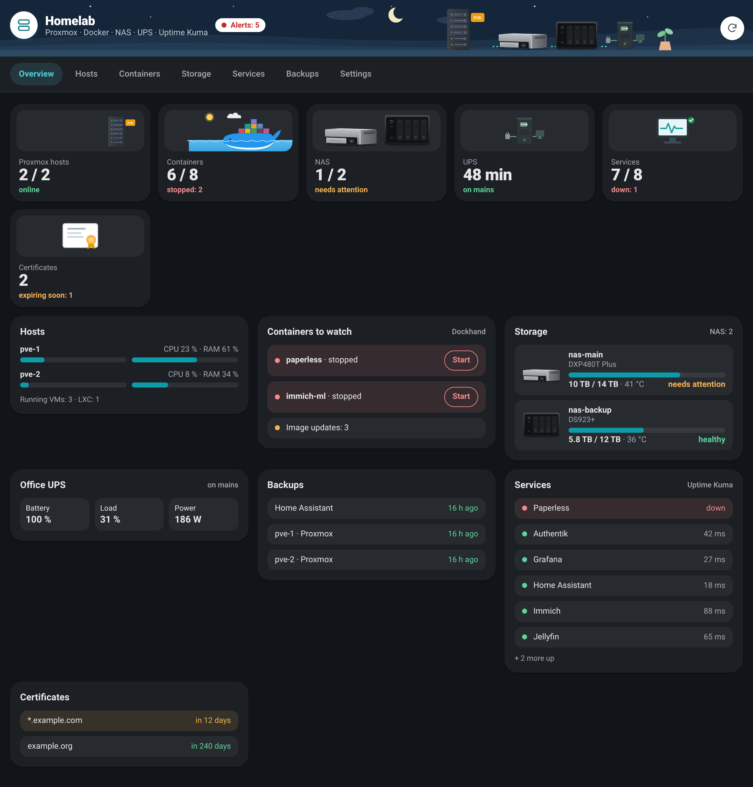 |
| 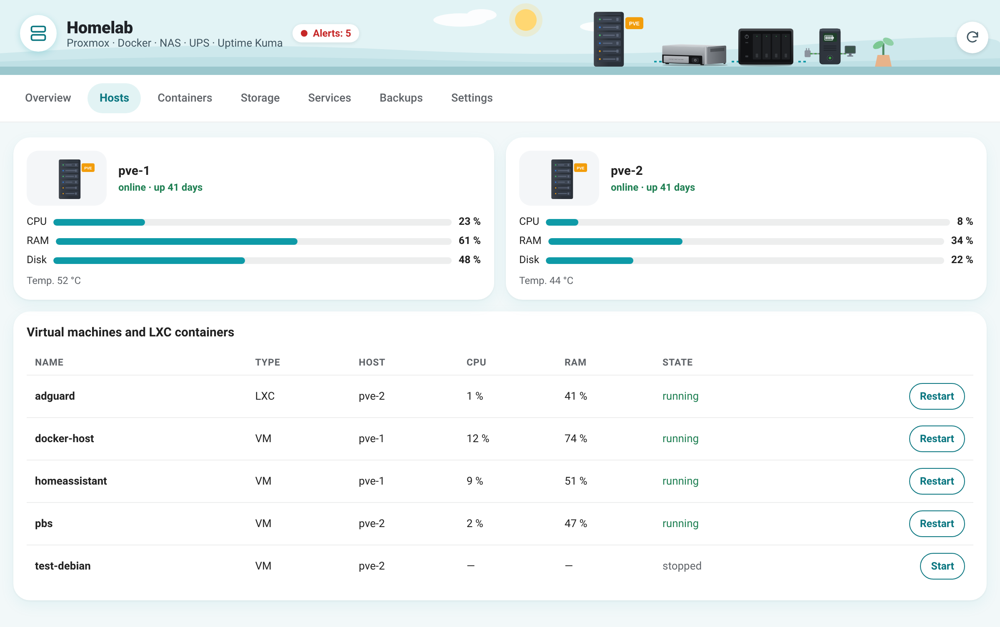 | 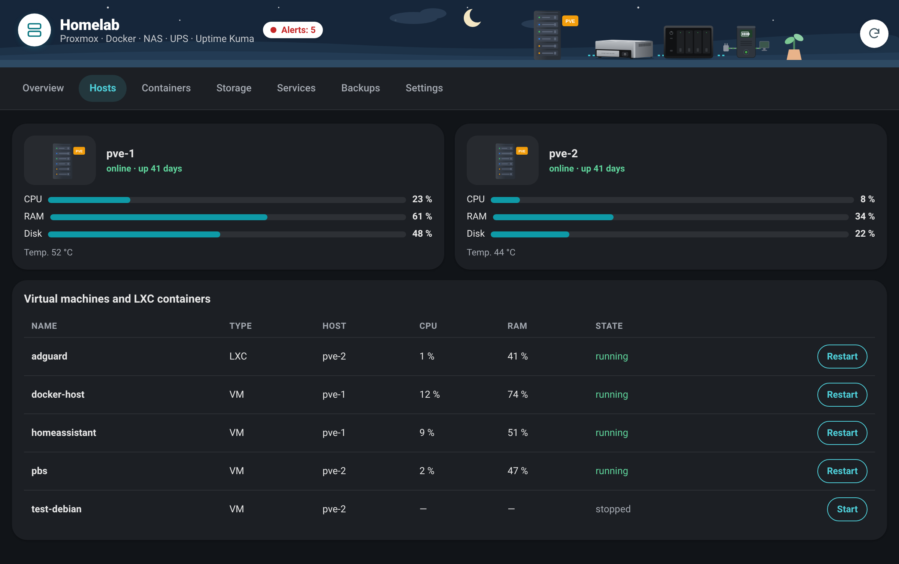 |
| 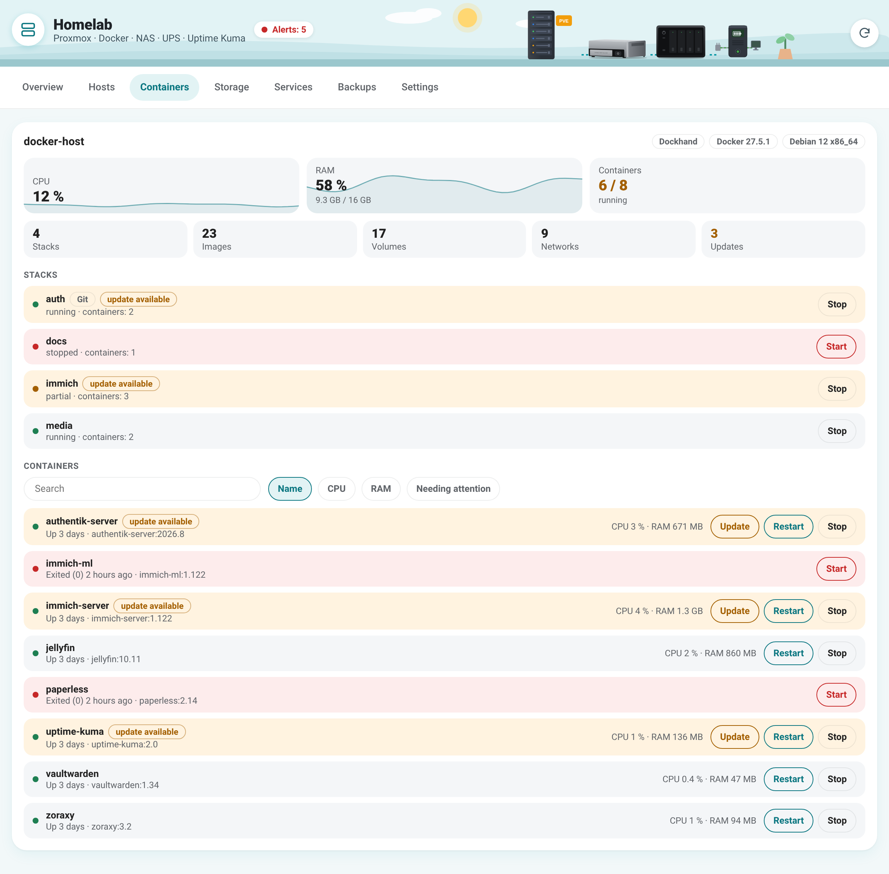 | 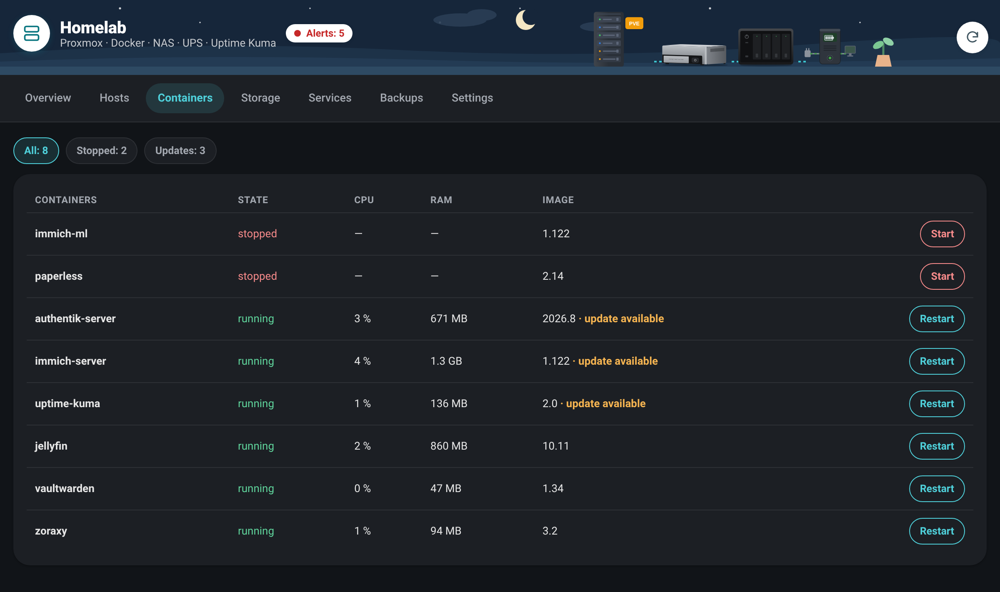 |
| 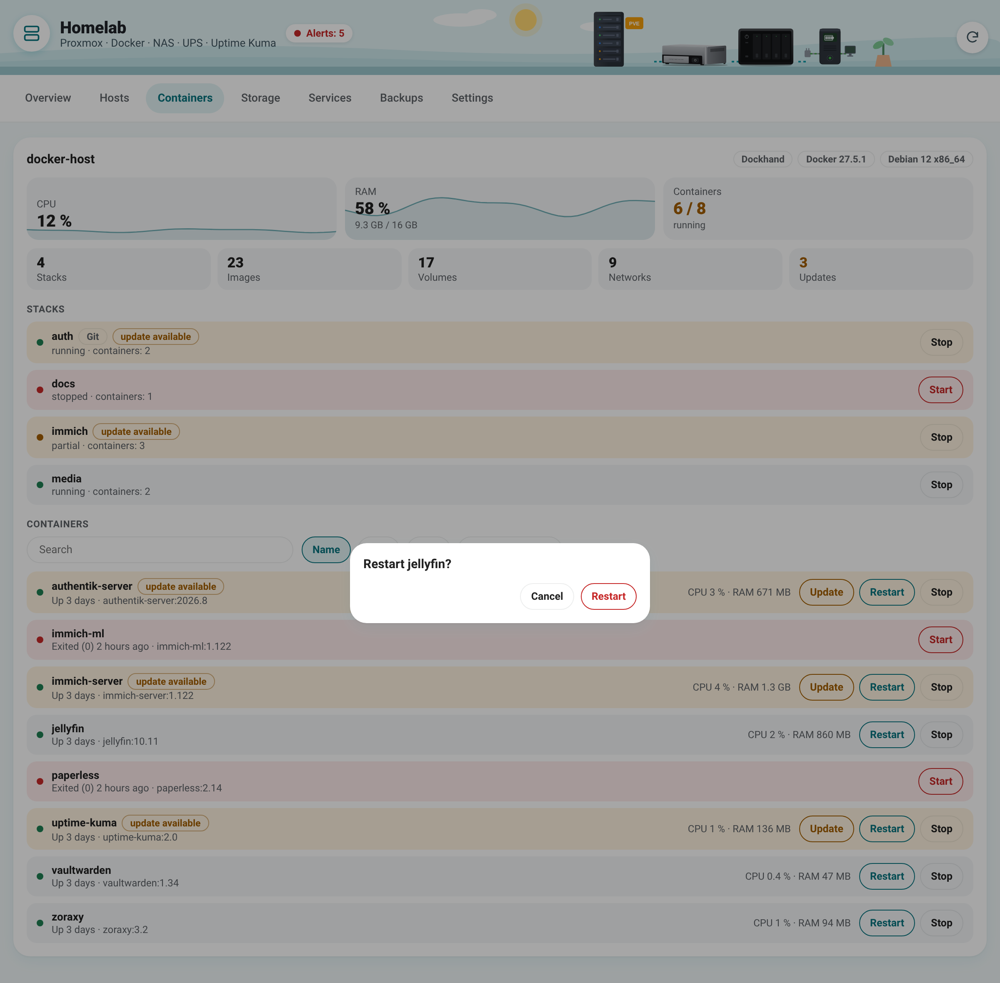 | 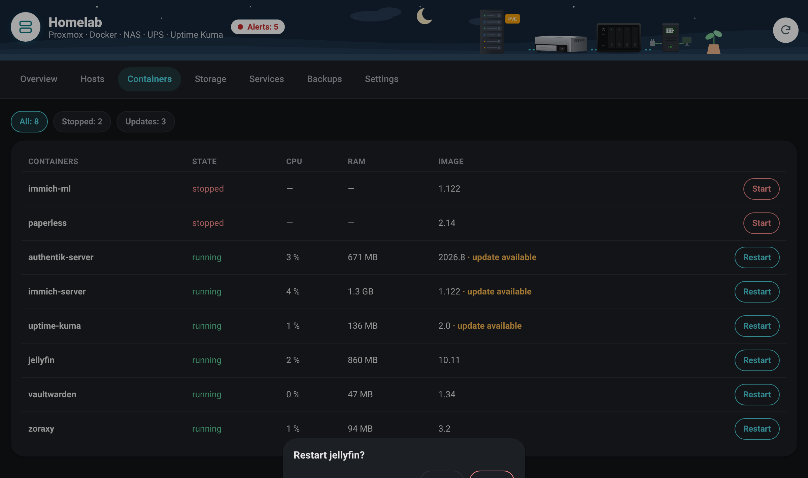 |
| 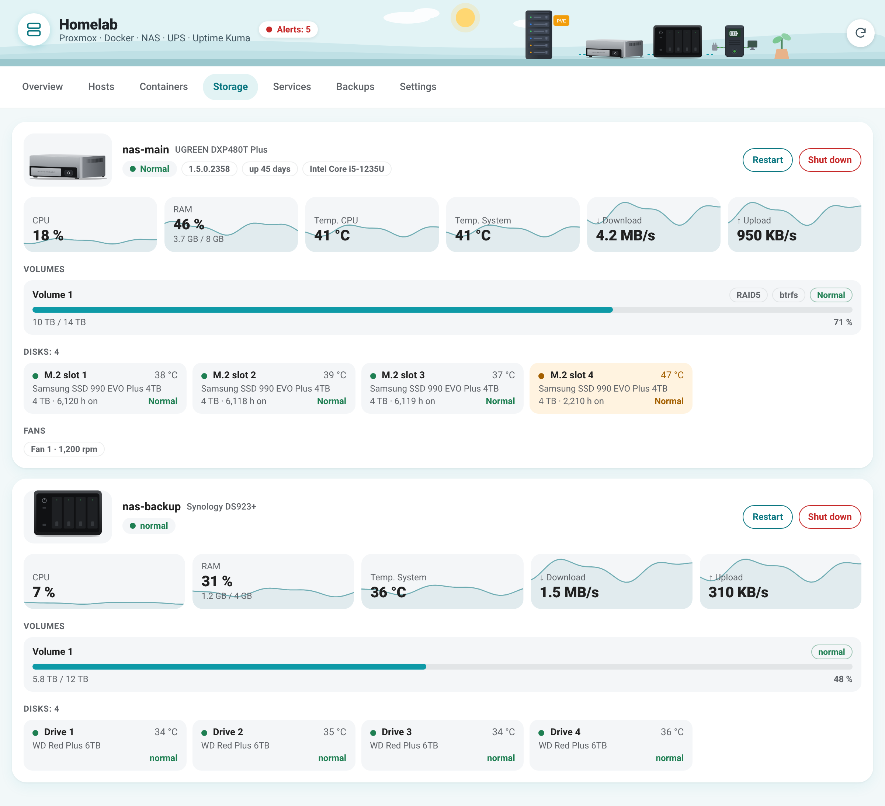 | 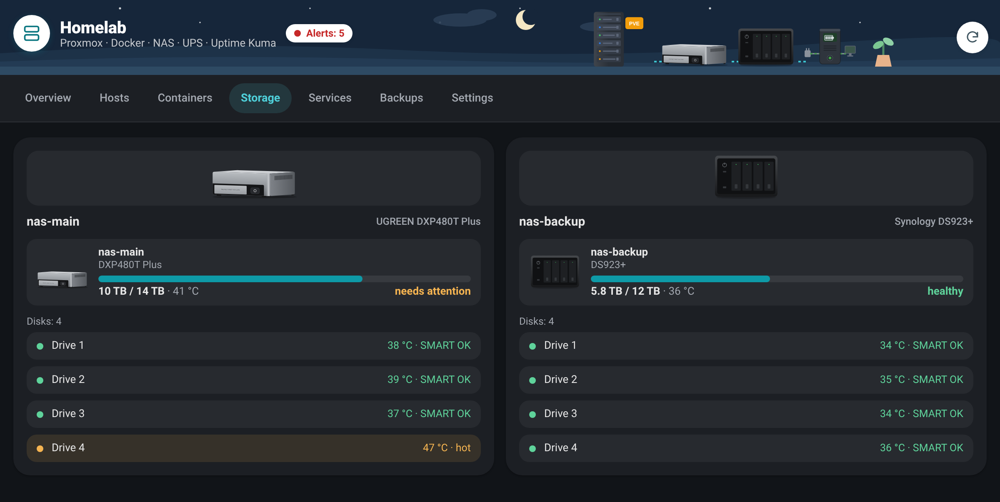 |
| 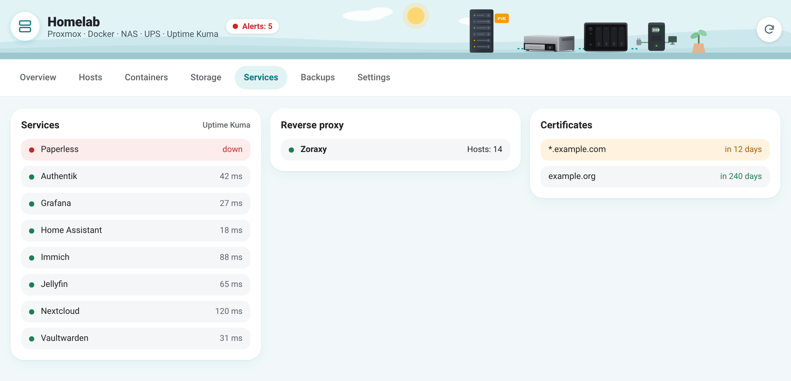 | 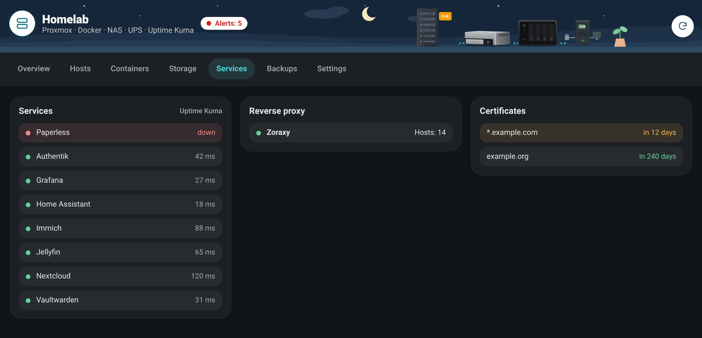 |
| 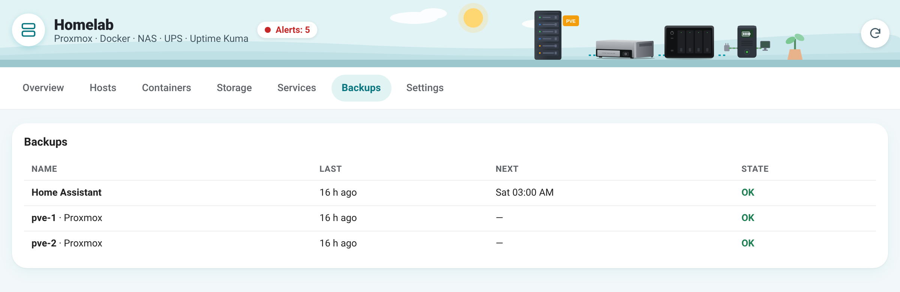 | 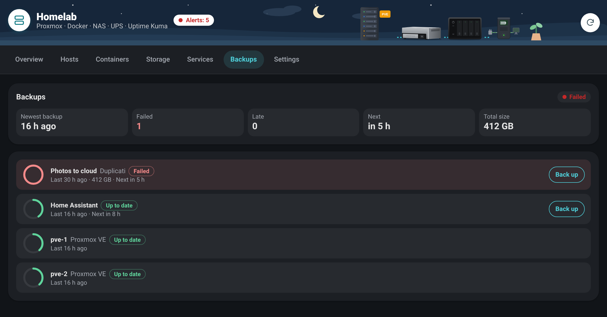 |
| 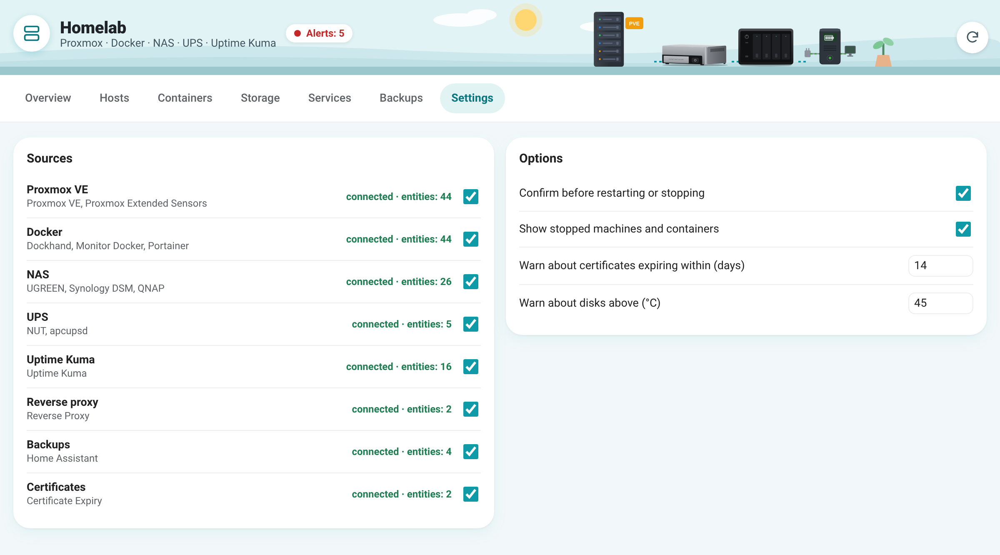 | 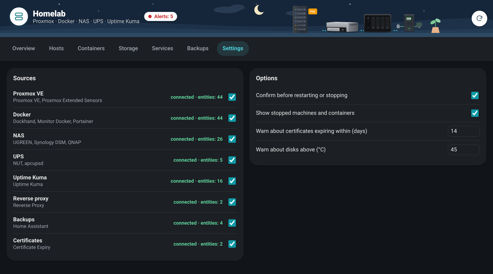 |

### Settings

The **Settings** tab, also reached from the integration's **Configure** button (sources only):

| Setting | Default | What it does |
|---|---|---|
| Sources | every source | The integrations the panel reads; a source left out is not scanned |
| Ask before a restart or a stop | on | Restart and stop wait for a confirmation |
| Show stopped machines and containers | on | Off: the Hosts and Containers tabs list the running ones only |
| Warn about certificates expiring within (days) | 14 | A certificate expiring sooner raises an alert (1–90) |
| Warn about drives above (°C) | 45 | A hotter NAS drive raises an alert (30–80) |

## How it works

The integration reads the device and entity registries and tells the panel which entity is which. For each source, it gathers the entities of the source's integrations by device, gives each device a kind (a Proxmox host, a virtual machine, an LXC container, a Docker host or container, a NAS, one of its drives or volumes — the NAS's child devices —, a UPS, a monitored service…) and each entity a role (status, CPU, temperature, battery, restart button…) from its translation key, unique ID and entity ID, so renamed entities and entities in another language are supported. Disabled entities are left out.

The inventory is scanned again only when the device or entity registry changes, an entry of a source changes state or title, or the sources shown change. The panel then reads the states as Home Assistant updates them, and redraws only when one of the entities it shows changes. An action is a press of the matching button entity (`button.press`) or a toggle of the container's switch.

Sizes are shown in decimal units (KB, MB, GB, TB), as the NAS integrations report them, and percentages as whole numbers.

## Development

```bash
pip install -r requirements_test.txt && pytest   # integration tests (Home Assistant test harness)
npm ci && npm test                               # assembles the panel (npm run build), then its tests
npm run screenshots                              # renders the panel with mock data into screenshots/
```

The panel (`homelab-panel.js`) is a plain JavaScript module served by the integration from `custom_components/homelab_panel/frontend/`, with its language files (`frontend/i18n/`). Its source is split into ES modules under `src/homelab-panel/` (entry `index.js`); `npm run build` (`scripts/build-frontend.mjs`) assembles them into `frontend/homelab-panel.js`, which is not committed (the release builds it into the zip). The modules share one scope, so top-level names stay unique across them, and a new module must be listed in `index.js`.

### Releasing

1. Bump the version in `custom_components/homelab_panel/manifest.json`, `const.py` (`VERSION`), `src/homelab-panel/core.js` (`HOMELAB_PANEL_VERSION`) and `package.json` (`npm install` updates `package-lock.json`)
2. Add a `## <version>` section at the top of [CHANGELOG.md](https://github.com/juju35/ha-homelab-panel/blob/main/CHANGELOG.md)
3. Merge to `main`: the **Release** workflow checks that the versions agree, creates the tag and the GitHub release with the changelog section as notes, and attaches `homelab_panel.zip`

## Translations

The panel auto-detects the language from your Home Assistant settings. English is built in; the other languages are loaded on demand. Currently supported:

| Language | Code |
|---|---|
| English | `en` |
| Français | `fr` |
| Deutsch | `de` |
| Español | `es` |
| Српски | `sr` |
| Srpski (latinica) | `sr-Latn` |
| Italiano | `it` |
| Nederlands | `nl` |
| Português (Portugal) | `pt` |
| Polski | `pl` |
| Română | `ro` |
| Dansk | `da` |
| Svenska | `sv` |
| Български | `bg` |
| Русский | `ru` |
| Українська | `uk` |
| Magyar | `hu` |
| Slovenčina | `sk` |
| Čeština | `cs` |
| Slovenščina | `sl` |
| Latviešu | `lv` |
| Ελληνικά | `el` |

Regional variants fall back to the base language (`it-IT` → `it`, `nl-BE` → `nl`); Brazilian Portuguese (`pt-BR`) uses the European Portuguese translation. Counts read "label: {n}" in every language (`Disks: 4`), so that no plural form is ever wrong.

Contributions for additional languages are welcome!

## Trademark

Proxmox®, Docker®, Portainer, UGREEN, Synology®, QNAP®, APC and Uptime Kuma are trademarks of their respective owners. This project is not affiliated with or endorsed by any of them; their logos are used only to identify the integrations it works with.

## License

MIT — see [LICENSE](https://github.com/juju35/ha-homelab-panel/blob/main/LICENSE).

## Support

If this project is useful to you, you can [buy me a coffee](https://buymeacoffee.com/julienstep9) ☕
